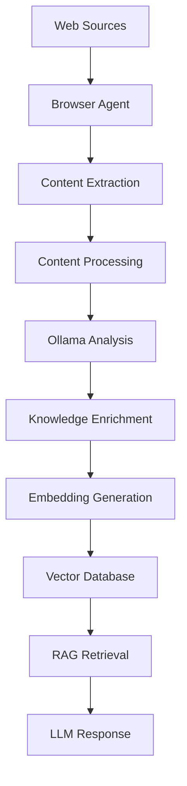

# Localith

# Localith

**Turn the Web into Your Local Intelligence.**

Localith is a local-first autonomous knowledge engine that transforms web content into structured, searchable knowledge using browser automation, local LLMs, and Retrieval-Augmented Generation (RAG).

It combines browser agents, Ollama, embedding models, and vector databases into a unified pipeline for collecting, processing, indexing, and retrieving knowledge — all running locally.

## ✨ Features

- **Autonomous Web Crawling** — Use browser agents to navigate websites and collect relevant information.
- **Intelligent Content Extraction** — Extract, clean, normalize, and structure raw web content.
- **AI-Powered Analysis** — Leverage local LLMs through Ollama to analyze, summarize, and enrich collected data.
- **Vector Indexing** — Generate embeddings and store knowledge in a vector database.
- **Local RAG** — Retrieve relevant context and generate grounded answers from your own knowledge base.
- **Privacy-First** — Keep your data, models, and knowledge infrastructure under your control.

## 🏗️ Architecture



## 🧠 Core Pipeline

| Stage | Responsibility |
|---|---|
| Crawling | Discover and collect web content |
| Extraction | Extract meaningful information |
| Processing | Clean and normalize raw data |
| Analysis | Use local LLMs to understand content |
| Enrichment | Transform content into structured knowledge |
| Indexing | Generate embeddings and store vectors |
| Retrieval | Find relevant context using semantic search |
| Generation | Answer questions using retrieved knowledge |

## 🛠️ Technology Stack

- **Browser Automation:** Browser Agents
- **Local LLM Runtime:** Ollama
- **Embeddings:** Configurable embedding models
- **Vector Database:** ChromaDB
- **RAG:** Retrieval-Augmented Generation

## 🎯 Vision

Localith aims to make building and maintaining a personal knowledge base autonomous, intelligent, and entirely local.

Instead of manually collecting documents and feeding them into an AI assistant, Localith lets agents explore the web, understand information, and continuously transform raw data into reusable knowledge.

**Your data. Your models. Your knowledge. Your machine.**

## Requirements

- macOS on Apple Silicon 
- Node.js 24+ (required by current agent-browser releases)
- Ollama installed and running
- Internet access to the target website

## 1. Install

```bash
# Install Node.js if needed
brew install node

# Install Ollama from https://ollama.com/download
# Then pull the local model
ollama pull qwen3:4b

# In the project folder
npm install
cp .env.example .env  # optional: edit model/crawl settings

# Download Chrome for Testing used by agent-browser
npx agent-browser install
```

`agent-browser` documents the project-local installation flow as `npm install agent-browser` followed by `agent-browser install`.

## 2. Start Ollama

Open a separate Terminal tab and run:

```bash
ollama serve
```

If Ollama is already running as a macOS app, you usually do not need to start it again.

Check the model:

```bash
ollama list
```

## 3. Run a scan

```bash
npm run scan -- https://example.com
```

Default settings:
- Crawl depth: `3`
- Maximum pages: `200`
- Delay between pages: `900ms`
- AI analysis: enabled
- Same hostname only
- `robots.txt` respected

## 4. Options

```bash
npm run scan -- https://example.com --depth 3 --max-pages 100 --delay-ms 1200
```

Available options:

| Option | Default | Meaning |
|---|---:|---|
| `--depth` | `3` | Maximum link depth from the starting page |
| `--max-pages` | `200` | Hard cap to prevent runaway crawls |
| `--max-pattern-pages` | `3` | Maximum pages to sample per dynamic pattern group at depth > 1 |
| `--delay-ms` | `900` | Minimum delay between pages |
| `--include-subdomains` | `false` | Also crawl subdomains |
| `--ignore-robots` | `false` | Do not apply robots.txt rules |
| `--auth` | `false` | Detect login walls and sign in with `AUTH_EMAIL`/`AUTH_PASSWORD` |
| `--auth-email <e>` | — | Login email (overrides `AUTH_EMAIL`) |
| `--auth-password <p>` | — | Login password (overrides `AUTH_PASSWORD`) |
| `--help` | — | Show help |

Environment variables can also be set in `.env` (copy `.env.example` to `.env`):

- `OLLAMA_URL`
- `OLLAMA_MODEL`
- `CRAWL_DEPTH`
- `MAX_PAGES`
- `CRAWL_DELAY_MS`
- `PAGE_TIMEOUT_MS`
- `MAX_SNAPSHOT_CHARS`
- `MAX_PAGE_TEXT_CHARS`
- `INCLUDE_SUBDOMAINS`
- `RESPECT_ROBOTS`
- `AUTH_EMAIL` — email used to sign in when `--auth` is enabled
- `AUTH_PASSWORD` — password used to sign in when `--auth` is enabled

## Auth walls (optional)

The scanner detects pages that look like login walls (login/sign-in URL paths, password fields, or sign-in language). When detected:

- **Without `--auth`**: the page is recorded as skipped with a hint to enable auth handling.
- **With `--auth`**: the crawler fills the email and password inputs from `AUTH_EMAIL`/`AUTH_PASSWORD` (or `--auth-email`/`--auth-password`), submits the login form, and re-checks the page. If sign-in succeeds, crawling continues from the logged-in page; otherwise the page is recorded as skipped.

Example:

```bash
cp .env.example .env
# edit AUTH_EMAIL and AUTH_PASSWORD, then
npm run scan -- https://example.com --auth
```

Only use this on sites you own or have permission to access.

## Dynamic URL Pattern Sampling

When crawling list or collection pages (e.g. issue trackers, ecommerce products, user records), deep link structures often generate hundreds of repetitive URLs with dynamic IDs:

```text
https://example.com/report-issues/ISS-GPDPFI
https://example.com/report-issues/ISS-J74ENW
https://example.com/report-issues/ISS-FOTF0M
https://example.com/report-issues/ISS-HJEG0K
...
```

For links at **`depth > 1`**:
- The crawler automatically detects dynamic parameterized patterns (e.g. `https://example.com/report-issues/{{id}}`).
- Crawls up to **3 sample items** (configurable via `--max-pattern-pages`).
- Marks subsequent matching items as `status: "skipped"` with the pattern group name.
- Allows the crawler to continue discovering and analyzing other unique sections of the website without consuming the crawl quota on identical template instances.

## 5. Output and Persistence

Each scan maps to a dedicated directory under `reports/<hostname>-<hash>/`:

```text
reports/
└── example-com-5ab12345/
    ├── report.md
    ├── report.json
    ├── queue.json           # pending uncrawled pages
    ├── auth-state.json      # saved browser cookies & session state (when authenticated)
    ├── knowledge.json       # cumulative machine-readable screen knowledge
    ├── knowledge.md         # human-readable architectural screen guide
    ├── screens/             # per-screen structured knowledge artifacts
    │   ├── screen-001.json
    │   └── screen-002.json
    └── pages/
        ├── page-0001.json
        ├── page-0001.snapshot.txt
        ├── page-0002.json
        └── page-0002.snapshot.txt
```

### Session Persistence & Resuming Crawls

- **Persistent Browser Session:** When running with `--auth`, browser authentication state (cookies, localStorage) is automatically saved to `auth-state.json`. Subsequent runs with the same start URL restore this session, bypassing the auth wall without needing to log in again.
- **Resuming Not-Crawled Pages:** If a crawl hits `--max-pages` or stops, pending discoverable URLs are preserved in `queue.json`. Running the scanner again with the same URL resumes from the previous state, preserving already crawled pages and continuing with the remaining uncrawled queue.

Each page record includes URL, depth, title, meta description, headings, discovered links, visible text, accessibility snapshot, crawl status and optional AI analysis.

## 6. AI Knowledge & Keywords API Endpoint

The AI Knowledge Engine consumes crawl output (`report.json` and page extractions), groups screens into unique static pages or parameterized pattern templates (e.g. `/report-issues/{{id}}`), and prompts Ollama to produce structured architectural knowledge and domain keywords for each screen.

### Start the HTTP Server

```bash
npm run serve
```

Server runs on `http://localhost:3000` (or configured `PORT`).

### Endpoints

| Method | Endpoint | Description |
|---|---|---|
| `POST` | `/api/knowledge` (or `/api/analyze`) | Consumes crawl results to produce knowledge & keywords |
| `GET` | `/api/reports` | List all available scan report runs |
| `GET` | `/api/reports/:id/knowledge` | Fetch saved knowledge JSON for a specific report run |
| `POST` | `/api/reports/:id/knowledge` | Generate/regenerate knowledge for a specific report run |
| `GET` | `/health` | Server and Ollama connection status |
| `GET` | `/` | API discovery and usage guide |

#### Example: Generate Knowledge via API

```bash
curl -X POST http://localhost:3000/api/knowledge \
  -H "Content-Type: application/json" \
  -d '{
    "runDir": "reports/example-com-5ab12345"
  }'
```

*(If no `runDir` or `reportPath` is provided in the request body, the server automatically analyzes the latest scan report).*

#### Output Schema

The endpoint returns:
- `totalScreens`: Total unique functional screens
- `totalPatternGroups`: Total dynamic pattern templates recognized
- `screens[]`: Array of screen specifications:
  - `screenName`: Human-friendly screen title (e.g. "Issue Details & Triage Viewer")
  - `screenType`: Functional category (`detail-view`, `dashboard`, `list-management`, etc.)
  - `pattern`: Exact URL or parameterized route (`/report-issues/{{id}}`)
  - `isPatternGroup`: `true` if grouped across parameterized instances
  - `purpose`: Primary business / functional purpose
  - `summary`: Comprehensive description
  - `keyWorkflows`: Actions users take on this screen
  - `dataEntities`: Domain objects displayed or updated
  - `uiComponents`: Key interface sections and controls
  - `keywords`: 10-15 domain & search keywords
- `globalKeywords`: Ranked keywords aggregated across the entire application
- `siteSummary`: Overall application synthesis

Artifacts are also saved to the run directory as:
- `knowledge.json`: cumulative machine-readable screen knowledge
- `knowledge.md`: human-readable architectural screen guide
- `screens/*.json`: per-screen detailed knowledge artifacts

### Incremental Persistence & Resumption

Like the crawler's page storage, Ollama screen knowledge is saved **immediately after each screen is processed**:
- **Per-Screen Artifacts:** Each screen analysis is stored in `screens/screen-XXX.json`.
- **Incremental State:** `knowledge.json` and `knowledge.md` are refreshed after each screen completes, so work is never lost if interrupted.
- **Resumption / Reuse:** When running again on the same report directory, previously analyzed screens are automatically recognized from `knowledge.json` or `screens/` and reused, skipping redundant Ollama calls.
- **Force Re-analysis:** Pass `--force` to the CLI (e.g. `npm run analyze -- --force`) or `"forceReanalyze": true` in API requests to re-run Ollama on all screens.

### CLI Shortcuts

Generate knowledge directly from the terminal without starting the server:

```bash
# Analyze the latest scan report (reusing any previously analyzed screens)
npm run analyze

# Or specify a report directory
npm run analyze -- reports/example-com-5ab12345

# Force re-analysis with Ollama even if screens were previously saved
npm run analyze -- --force
npm run analyze -- reports/example-com-5ab12345 --force
```

## 7. RAG Vector Database (ChromaDB + nomic-embed-text)

Once a scan completes and generates `knowledge.json`, you can index the entire application knowledge base into **ChromaDB** using Ollama's `nomic-embed-text` embedding model. This turns your crawl into a searchable RAG vector database that answers user questions about screens, workflows, and user actions.

### 1. Ensure Ollama Has `nomic-embed-text`

```bash
ollama pull nomic-embed-text
```

### 2. Start ChromaDB (if running locally)

```bash
# Using Python
pip install chromadb
chroma run --path ./chroma_data --port 8000

# Or using Docker
docker run -p 8000:8000 chromadb/chroma
```

### 3. Index Knowledge into ChromaDB

You can index via CLI or HTTP API with a **dynamic collection name**:

#### Via CLI:

```bash
# Index latest crawl report with automatic collection name
npm run rag:index

# Index with a custom dynamic collection name
npm run rag:index -- --collection example_admin

# Index a specific report or knowledge file
npm run rag:index -- reports/example-com-5ab12345 --collection example_admin
```

#### Via HTTP Endpoint:

```bash
curl -X POST http://localhost:3000/api/rag/index \
  -H "Content-Type: application/json" \
  -d '{
    "collectionName": "example_admin",
    "runDir": "reports/example-com-5ab12345",
    "embedModel": "nomic-embed-text"
  }'
```

The indexer extracts and embeds:
- **Screen Overview Chunks:** High-level screen summaries, types, entities, UI controls, and URLs.
- **Action & Workflow Chunks:** Individual tasks and workflows (e.g. creating reports, filtering, exporting) with screen context.
- **Site Overview Chunk:** Broad application architecture and domain keywords.

### 4. Search the RAG Database & Ask Questions

Ask questions against the indexed application knowledge base:

#### Via CLI:

```bash
# Example user questions:
npm run rag:search -- "how can I create a report?"
npm run rag:search -- "what is perk template?"
npm run rag:search -- "how do I reset password?"
npm run rag:search -- "I want create quiz for my student how can I do it?"

# Specify a collection:
npm run rag:search -- "how can I create a report?" --collection example_admin
```

#### Via HTTP Endpoint:

```bash
# POST /api/rag/search
curl -X POST http://localhost:3000/api/rag/search \
  -H "Content-Type: application/json" \
  -d '{
    "query": "how can I create a report?",
    "collectionName": "example_admin",
    "nResults": 5,
    "generateAnswer": true
  }'

# Or GET /api/rag/search
curl "http://localhost:3000/api/rag/search?q=how+can+I+create+a+report&collection=example_admin"
```

The response includes:
- `answer`: An AI-synthesized, step-by-step answer citing exact screen names and route URLs.
- `results`: Ranked matching screens and workflows with similarity scores and snippet documents.

### 5. List Collections

```bash
curl http://localhost:3000/api/rag/collections
```

## 8. Notes and limitations

- This is a **same-host crawler**, not a search-engine-scale crawler. It discovers pages through links rendered in the browser. Some pages may be inaccessible due to login, bot protection, consent walls, or client-side interactions.
- `agent-browser snapshot` is an accessibility tree, not a screenshot. DOM extraction is used alongside it to discover ordinary anchor links and visible text.
- JavaScript-heavy pages are rendered by Chromium before extraction.
- The default page cap is 200. Increase it deliberately if the site is large.
- `robots.txt` is respected by default. Only crawl sites you own or have permission to inspect. Do not use this to bypass authentication, paywalls, rate limits, or access controls.
- A website may link to very large URL spaces (calendar pages, search filters, tracking parameters). The crawler removes common tracking parameters and enforces a maximum page count.
- Ollama analysis is local; the browser still connects to the target website over the internet.

## Troubleshooting

### `agent-browser: command not found`

The project installs `agent-browser` locally. Run `npx agent-browser --help` to verify the binary is available. When launched through `npm run scan`, npm adds the local binary directory to PATH.

### Ollama connection error

Make sure the Ollama app is running or run:

```bash
ollama serve
curl http://127.0.0.1:11434/api/tags
```

### Model not found

```bash
ollama pull qwen3:4b
ollama list
```

### Browser installation

```bash
npx agent-browser install
npx agent-browser doctor
```

## License

Project source: MIT. `agent-browser`, Ollama and the selected model retain their own licenses and terms.
